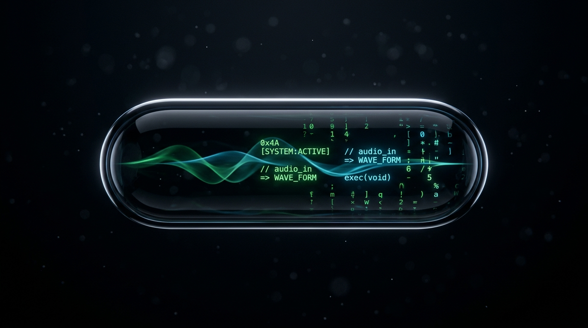
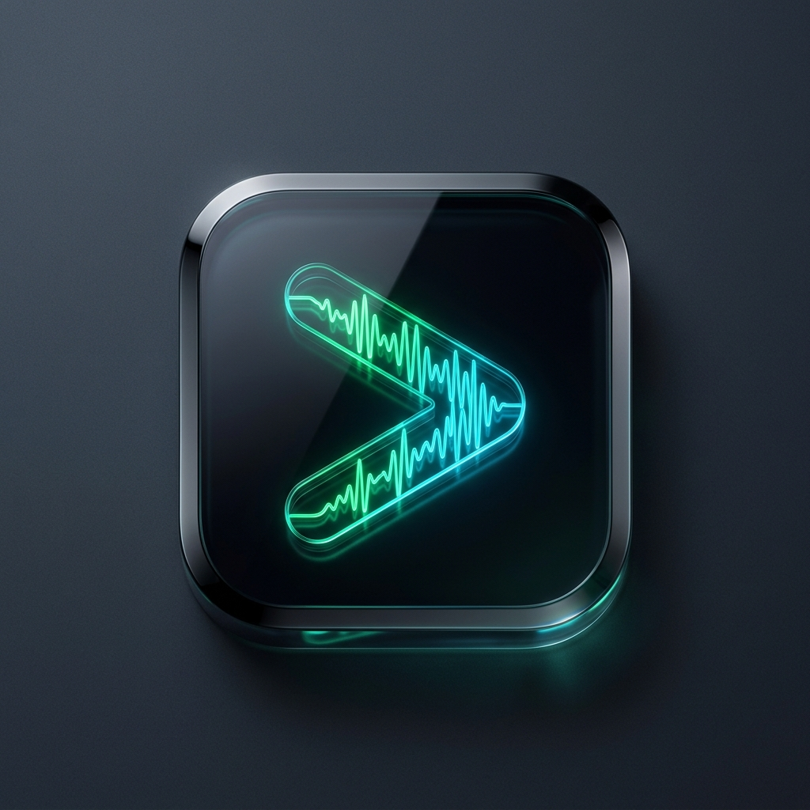
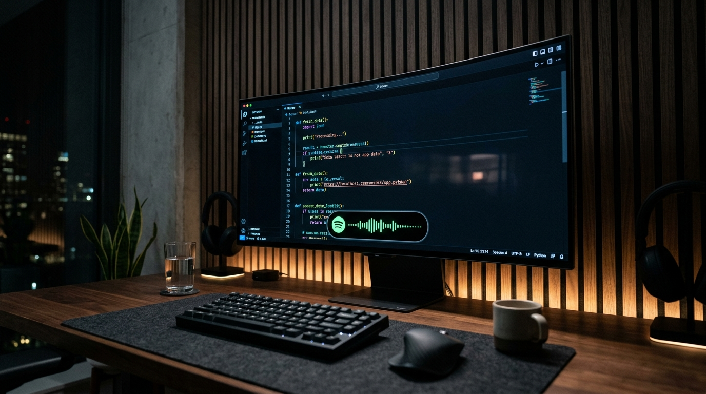
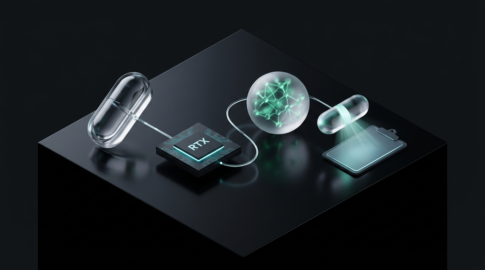

<p align="center">
  
</p>

<p align="center">
  
</p>

# Speech-to-Prompt Pipeline e Dynamic Island

<p align="center">
  
  
  
  
  
  
</p>

Se você programa ou cria soluções com IA todo dia, sabe que cansa ter que parar o raciocínio pra digitar prompts longos e cheios de contexto na mão. Eu criei esse pipeline pra resolver essa dor no meu próprio fluxo: falar o que eu preciso em voz alta e ter um prompt técnico, limpo e estruturado colado no `Ctrl + V` em menos de dois segundos.

Tudo roda 100% local na GPU da minha máquina (uma RTX 4050 de 6 GB), sem depender de APIs pagas na nuvem. O áudio passa pelo Faster-Whisper pra transcrição imediata, vai pro Ollama (Qwen 2.5) pra lapidar o texto e exibe tudo numa interface flutuante inspirada na Dynamic Island da Apple.

---

## Como você usa no dia a dia

O modo desktop foi feito pra você nunca precisar tirar a mão do teclado ou trocar a janela do seu editor:

<p align="center">
  
</p>

Você inicia a ferramenta com dois cliques no atalho **Speech to Prompt** na sua Área de Trabalho. Ela sobe em segundo plano, direto na memória, sem abrir nenhuma janela preta de console:

1. **Aperte F8 em qualquer tela.** Não importa se você está no VS Code, no navegador ou no terminal. Um som suave avisa você que o microfone abriu.
2. **Fale naturalmente.** A pílula flutuante mostra o seu equalizador de voz em tempo real e a transcrição ao vivo na tela a 60 FPS com física de molas.
3. **Aperte F8 de novo pra concluir.** Um segundo som confirma o término. Em cerca de 1.5s, o seu prompt estruturado já está no clipboard, pronto pra você dar `Ctrl + V` no Claude, Gemini ou ChatGPT.

---

## Início Rápido

Pra colocar o projeto pra rodar no seu computador, você só precisa clonar o repositório e seguir estes passos:

```powershell
# 1. Clone o repositório e ative o seu ambiente virtual
git clone https://github.com/daniloofrs/speech-to-prompt-pipeline.git
cd speech-to-prompt-pipeline
python -m venv venv
.\venv\Scripts\Activate.ps1

# 2. Instale as dependências e gere o seu arquivo de ambiente
pip install -r requirements.txt
cp .env.example .env

# 3. Baixe os modelos locais no seu Ollama
ollama pull qwen2.5:3b
ollama pull qwen2.5:7b

# 4. Crie o seu atalho na Área de Trabalho com ícone oficial
powershell -ExecutionPolicy Bypass -File tools/criar_atalho.ps1
```

Se o seu objetivo for apenas usar o assistente flutuante de voz no cotidiano, você não precisa ligar o Docker. O modo desktop roda direto na sua placa de vídeo e na sua memória RAM.

---

## Trilha Batch e Governança com PostgreSQL

Além do assistente de produtividade instantâneo, montei uma trilha em lote pensada pra Engenharia de Dados e LLMOps. Se você quiser processar arquivos de áudio em lote, evitar duplicatas e medir a assertividade das respostas da IA no seu histórico, essa trilha cuida de tudo.

<p align="center">
  
</p>

Suba o seu banco de dados via Docker:

```powershell
docker compose up -d
```

Execute o fluxo de ingestão e a sua auditoria:

```powershell
# Ingestão com hash SHA-256 estrito (impede você de reprocessar o mesmo áudio)
python src/ingest.py data/samples/teste.wav

# Reescrita estruturada com o seu LLM local
python src/rewrite.py

# Resumo analítico de curadoria humana (taxa de aprovação direta e alucinações)
python src/evaluate.py --summary
```

### Por que separamos em duas trilhas?

- **Live Desktop:** Foco total na sua agilidade diária com o atalho F8. Usa o Qwen 2.5 de 3B parâmetros pra entregar a resposta em ~1.5s no seu clipboard.
- **Batch Pipeline:** Foco em rastreabilidade, persistência segura no PostgreSQL 16 e auditoria profunda com o modelo de 7B parâmetros.

---

## Dashboard Web e Shader de Vidro Líquido

Pra você acompanhar as métricas do seu banco de dados de um jeito visual, criei um dashboard web com um efeito óptico de vidro líquido (Liquid Glass), inspirado nos experimentos de SVG de [Shu Ding](https://github.com/shuding/liquid-glass).

<p align="center">
  
</p>

Abra o painel no seu navegador:

```powershell
python src/dashboard.py --open
```

O painel abre em `http://localhost:8080` (ou no terminal se você preferir passar `--cli`). A nossa pílula na página usa filtros SVG nativos (`<feDisplacementMap>` e `<feGaussianBlur>` com 52px de desfoque) pra distorcer os elementos que passam por trás dela, com controles pra você ajustar opacidade e refração ao vivo.

---

## Cuidados de Engenharia e Memória de Vídeo

Quando eu comecei a juntar Whisper e LLM no mesmo computador, o meu maior cuidado foi não estourar os 6 GB de VRAM da minha placa de vídeo. Se a memória estoura, o Windows joga dados pra RAM e o seu tempo de resposta salta de 1.5s pra mais de 10s.

Ajustei a distribuição de memória pra manter o seu setup leve e veloz:

- **Faster-Whisper Medium FP16:** consome ~1.5 GB da sua VRAM.
- **Ollama Qwen 2.5 (3B em Q4_K_M):** ocupa ~1.9 GB da sua VRAM.
- **Buffers do Windows e DWM:** reservam cerca de ~0.8 GB da máquina.
- **Total:** ~4.2 GB de VRAM ocupados, deixando uma folga segura nos 6 GB da GPU pra você manter o seu VS Code e navegador abertos sem engasgos.
- **Calibração de vocabulário:** configurei um prompt fonético inicial (`TECH_INITIAL_PROMPT`) pra orientar o Whisper a reconhecer termos de tecnologia em português sem você ter que corrigir palavras como *Docker, FastAPI, SQL, PyTorch e Git*.

---

## Estrutura do Projeto

```text
speech-to-prompt-pipeline/
├── assets/                  # Identidade visual e imagens geradas com Nano Banana
│   ├── app-icon.ico         # Ícone oficial pro atalho do Windows
│   ├── app-icon.png         # Logo em squircle pra web e avatar
│   ├── hero-banner.png      # Banner panorâmico do repositório
│   ├── liquid-glass-macro.png # Detalhe da refração óptica SVG
│   ├── pipeline-isometric.png # Diagrama 3D da arquitetura
│   └── setup-desktop.png    # Pílula flutuante no fluxo de trabalho
├── sql/                     # Migrações e tabelas do PostgreSQL
├── src/
│   ├── config.py            # Variáveis de ambiente e caminhos
│   ├── database.py          # Conexão psycopg v3 e consultas SQL
│   ├── ingest.py            # Ingestão de áudio, SHA-256 e Faster-Whisper
│   ├── rewrite.py           # Prompt engineering e chamada ao Ollama
│   ├── evaluate.py          # Interface de curadoria humana e métricas
│   ├── dashboard.py         # Servidor web com Liquid Glass e modo CLI
│   └── live_pill.py         # Dynamic Island em Tkinter com física e atalho F8
├── tools/criar_atalho.ps1   # Script PowerShell pra gerar o atalho desktop
├── iniciar_live.vbs         # Inicializador silencioso sem janela de prompt
├── docker-compose.yml       # Configuração do PostgreSQL 16 Alpine
└── README.md                # Documentação do projeto
```

---

## Autor

Desenvolvido por **Danilo Fernandes** pra servir como projeto prático de portfólio em Engenharia de Dados e aplicações locais com modelos de linguagem.

- GitHub: [@daniloofrs](https://github.com/daniloofrs)
