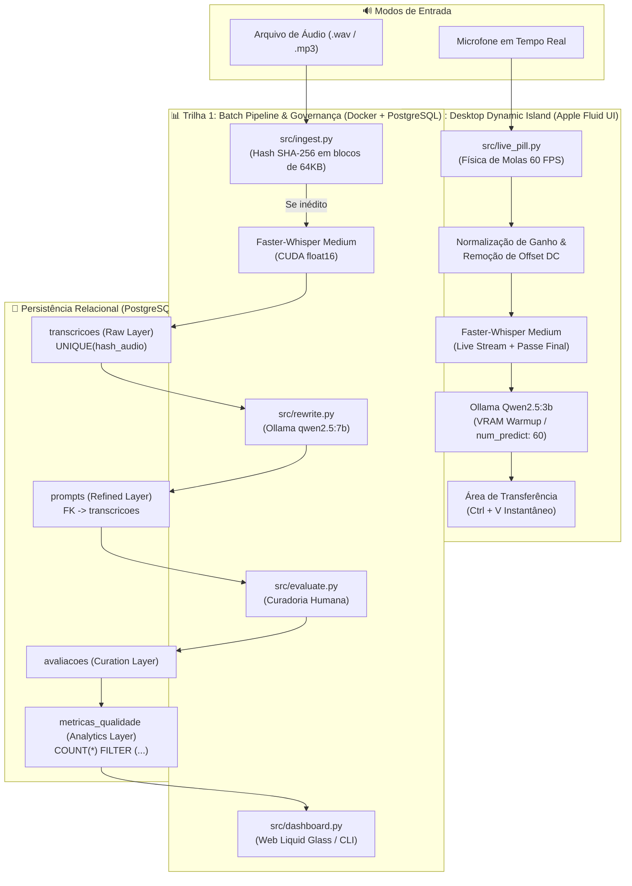

# 🎙️ Speech-to-Prompt Pipeline & Dynamic Island

<p align="center">
  
  
  
  
  
  
  
</p>

> **Pipeline de Engenharia de Dados & LLMOps com Widget Desktop Estilo Apple Dynamic Island:** Ingestão de áudios em português, transcrição em tempo real com Whisper acelerado por GPU, reescrita estruturada de prompts via LLM local (Ollama), governança com métricas de qualidade persistidas em PostgreSQL e pílula desktop fluida com física de molas (Springs a 60 FPS) e cópia instantânea para o `Ctrl + V`.

---

## 📌 Visão Geral e Proposta de Valor

Em fluxos de trabalho reais de desenvolvimento e análise, comandos falados por usuários contêm hesitações (*"tipo assim"*, *"ééé"*), ambiguidades, redundâncias e falta de contexto estruturado. 

Este projeto aborda o problema sob duas perspectivas complementares de **Engenharia de Software e Dados**:

1. **Pipeline de Governança em Lote (Batch Pipeline & LLMOps):**
   - Ingestão estritamente idempotente baseada em streaming SHA-256.
   - Transcrição precisa em português via `faster-whisper` (modelo `medium`) com tensores `float16` na GPU NVIDIA RTX 4050.
   - Reescrita estruturada do pedido via LLM local (`qwen2.5:7b` ou `qwen2.5:3b`) em temperatura controlada (`0.1`), separando a instrução final imperativa de eventuais dúvidas técnicas.
   - Camada de curadoria humana com métricas automatizadas no banco: **Taxa de Aceitação Direta**, **Taxa de Edição** e **Taxa de Alucinação**.
   - Dashboard analítico web moderno com efeito translúcido (*Liquid Glass*) e modo terminal CLI.

2. **Ferramenta de Produtividade Desktop (Apple Dynamic Island Live Pill):**
   - Widget flutuante *Always-on-Top* sem bordas posicionado no inferior-meio da tela.
   - **Streaming ao vivo:** as palavras aparecem na tela **enquanto você fala** (atualização contínua a cada ~550ms).
   - **Física de Molas Apple (WWDC Fluid Interfaces):** transições fluidas a 60 FPS parametrizadas por *damping ratio* e *response*, resposta instantânea no *pointer-down* (compressão tátil), manipulação 1:1, *rubber-banding* nas bordas do monitor e projeção de momento (*flick velocity handoff*).
   - **Áudio Reativo:** equalizador com 5 barras estilo *Apple Voice Memos* sincronizadas com a energia RMS do microfone.
   - **Zero dependência de Docker:** opera 100% em memória RAM e GPU, entregando o prompt pronto no clipboard do Windows em ~2 segundos.

---

## 🏗️ Arquitetura do Sistema



---

## 💡 Decisões Técnicas de Engenharia

### 1. Idempotência em Duas Camadas
- **Nível de Aplicação:** O hash SHA-256 é calculado por streaming em blocos de 64 KB, impedindo sobrecarga de memória RAM mesmo com arquivos grandes. Caso o hash já exista no banco, a execução do Whisper é cancelada antes de tocar a GPU.
- **Nível de Banco:** A coluna `hash_audio VARCHAR(64) UNIQUE` protege contra concorrência via `INSERT INTO ... ON CONFLICT (hash_audio) DO NOTHING`.

### 2. Dimensionamento de VRAM na RTX 4050 (6 GB GDDR6)
No modo interativo desktop em tempo real, a saturação de VRAM causa o fenômeno de *CUDA Memory Paging* (transferência de tensores pela PCIe para a memória RAM do sistema), aumentando o tempo de inferência do LLM de ~2s para mais de 9s.
Para garantir estabilidade e fluidez simultâneas:
- **Faster-Whisper Medium (`float16`):** ~1.5 GB de VRAM.
- **Ollama Qwen2.5:3b (Q4_K_M):** ~1.9 GB de VRAM.
- **Ambiente Windows DWM & Buffers:** ~0.8 GB de VRAM.
- **Total ocupado:** ~4.2 GB de 6.0 GB (margem de segurança de ~1.8 GB sem swapping).
- **Pré-aquecimento (*VRAM Warmup*):** Uma thread dedicada carrega o modelo do disco no boot com `keep_alive: 60m`, garantindo zero tempo de inicialização a frio (*cold start*).

### 3. Física de Interfaces Fluídas (Apple Design Principles)
O widget `src/live_pill.py` foi projetado com base nas diretrizes da WWDC (*Designing Fluid Interfaces*):
- **Equação de Molas Reversíveis:** Utiliza parâmetros intuitivos de *damping ratio* ($\zeta$) e *response* ($\tau$), convertidos em rigidez $k = (2\pi / \tau)^2$ e amortecimento $c = 4\pi\zeta / \tau$. Isso permite redirecionar a animação em qualquer milissegundo sem solavancos.
- **Resposta no *Pointer-Down*:** Feedback visual imediato ao encostar o dedo/cursor (`scale = 0.965`), sem aguardar a soltura do clique.
- **Resistência de Borda (*Rubber-Banding*):**
  $$\text{deslocamento} = \frac{\text{overshoot} \times \text{dimensao} \times 0.55}{\text{dimensao} + 0.55 \times |\text{overshoot}|}$$
- **Projeção de Momento (*Flick Momentum*):** Ao arremessar o widget, a velocidade residual projeta o ponto de repouso antes do pouso elástico:
  $$\Delta x = \frac{v_{\text{inicial}}}{1000} \times \frac{d}{1 - d} \quad (d = 0.992)$$

### 4. Calibração Fonética e Vocabulário Técnico
Adicionamos o `TECH_INITIAL_PROMPT` para condicionar o decodificador do Whisper em português:
> *"Transcrição em português brasileiro com pontuação precisa e vocabulário técnico: Python, SQL, PostgreSQL, Docker, FastAPI, React, JavaScript, TypeScript, Linux, Git, API REST, banco de dados, função, query, pipeline, script, frontend, backend."*

---

## 🛠️ Tecnologias Utilizadas

| Componente | Tecnologia | Finalidade |
|---|---|---|
| **Linguagem** | Python 3.12 | Base de todo o ecossistema |
| **Banco Relacional** | PostgreSQL 16 Alpine | Armazenamento de dados brutos, refinados e métricas |
| **Orquestração** | Docker Compose | Isolamento e persistência do banco (`postgres_data`) |
| **Driver de Banco** | psycopg v3 (`psycopg[binary]`) | Conexão de alto desempenho com timeouts resilientes |
| **Transcrição (ASR)** | faster-whisper (CTranslate2) | Reconhecimento de fala acelerado por CUDA FP16 |
| **Aceleração GPU** | NVIDIA CUDA 12 Runtime | Execução na RTX 4050 sem necessidade de Toolkit |
| **LLM Local** | Ollama (`qwen2.5:7b` e `qwen2.5:3b`) | Reescrita estruturada com contexto restritivo |
| **Áudio em Memória** | SoundDevice & NumPy | Captura e normalização de microfone em 16 kHz mono |
| **Área de Transferência**| Pyperclip | Injeção transparente no clipboard do SO (`Ctrl + V`) |
| **Interface Desktop** | Tkinter Canvas & Apple HIG | Cápsula arredondada com renderização matemática e molas |

---

## 🚀 Instalação e Configuração

### 1. Pré-requisitos
- **Windows 10/11** ou **Linux**.
- **Python 3.11+** (recomendado 3.12).
- **Docker Desktop** ativo.
- **Ollama** instalado. Baixe os modelos recomendados:
  ```bash
  ollama pull qwen2.5:3b
  ollama pull qwen2.5:7b
  ```

### 2. Configurar o Ambiente Virtual
```powershell
# Clonar o repositório
git clone https://github.com/daniloofrs/speech-to-prompt-pipeline.git
cd speech-to-prompt-pipeline

# Criar e ativar o ambiente virtual
python -m venv venv
.\venv\Scripts\Activate.ps1

# Instalar dependências
pip install -r requirements.txt
```

### 3. Configurar Variáveis de Ambiente
Copie o template `.env.example` para `.env`:
```powershell
cp .env.example .env
```
*(O arquivo já vem configurado com as portas locais, usuário padrão e modelo `medium` do Whisper).*

### 4. Inicializar o Banco de Dados
```powershell
docker compose up -d
```
As migrações SQL na pasta `sql/` são executadas automaticamente no primeiro boot do container:
- `01_init.sql` (Tabela `transcricoes`)
- `02_prompts.sql` (Tabela `prompts`)
- `03_avaliacoes.sql` (Tabelas `avaliacoes` e `metricas_qualidade`)

---

## 📋 Como Usar

### Modo 1: Dynamic Island Desktop (Uso Rápido no Dia a Dia)
Para ditar comandos de programação enquanto você navega ou desenvolve e colá-los direto no seu editor ou chat de IA:

#### Opção A: 1 Clique na Área de Trabalho (Recomendado - Zero Terminal)
- Dê dois cliques no atalho **`Speech to Prompt`** na sua Área de Trabalho (criado automaticamente via `tools/criar_atalho.ps1`).
- O assistente sobe 100% silencioso em segundo plano através do `pythonw.exe` **sem nenhuma janela de terminal aberta**.

#### Opção B: Pelo Terminal
```powershell
.\venv\Scripts\python src/live_pill.py
```

- **Atalho Global no Windows (`F8`):** Pressione **`F8`** em qualquer programa (VS Code, Chrome, Terminal) para começar a falar com feedback sonoro suave. Pressione **`F8`** novamente para concluir a gravação.
- **Feedback Sonoro (Chimes):** Som suave de ativação ao iniciar a escuta e chime de confirmação assim que o prompt estiver pronto no `Ctrl + V`.
- **Streaming ao Vivo:** As ondas de voz reagem à amplitude do microfone e as palavras são transcritas em tempo real.
- **Prompt Instantâneo:** O áudio é finalizado, normalizado, reescrito pelo Ollama em ~1.5s e **copiado automaticamente para seu `Ctrl + V`**.
- **Arrastável:** Clique e arraste para qualquer lugar da tela com inércia física a 60 FPS (molas Apple).
- **Independente:** Não exige Docker nem PostgreSQL.

---

### Modo 2: Pipeline em Lote (Engenharia de Dados & Auditoria)

#### Passo 1: Ingestão de Áudio
Coloque o arquivo de áudio na pasta `data/samples/` e execute:
```powershell
python src/ingest.py data/samples/teste.wav
```
> [!NOTE]
> Se você rodar o mesmo comando novamente, o pipeline detectará o hash SHA-256 e interromperá o processamento, demonstrando a **idempotência estrita**.

#### Passo 2: Reescrita Estruturada com LLM
Transforme a transcrição armazenada no PostgreSQL em um pedido refinado para IA:
```powershell
# Processa o último áudio ingerido
python src/rewrite.py

# Ou especifique um ID específico
python src/rewrite.py --id 1
```

#### Passo 3: Avaliação de Qualidade (LLMOps Curation)
Abra a CLI interativa para auditar o pedido e atualizar as métricas de alucinação e edição humana:
```powershell
python src/evaluate.py
```
Para consultar o sumário analítico no terminal:
```powershell
python src/evaluate.py --summary
```

#### Passo 4: Dashboard Analítico Web (com SVG Liquid Glass Shader)
Inicie o servidor de telemetria nativo com interface refrativa baseada em shaders ópticos:
```powershell
python src/dashboard.py --open
```
- Acesse em: `http://localhost:8080`
- **Liquid Glass Shader (Shu Ding inspired):** Dynamic Island web arrastável com refração física em tempo real via SVG `<feDisplacementMap>` e mapa gerado matematicamente com *Signed Distance Field* (`roundedRectSDF`). Arraste a lente sobre os números e tabelas para ver a luz se refratar organicamente nas bordas curvas.
- **Botão de Alternância de Refração:** Permite comparar instantaneamente o efeito de refração óptica SVG contra o *backdrop-filter: blur* genérico.
- Modo terminal puro: `python src/dashboard.py --cli`

---

## 📁 Estrutura do Repositório

```text
speech-to-prompt-pipeline/
├── data/
│   └── samples/             # Amostras de teste locais (.wav, .mp3)
├── sql/
│   ├── 01_init.sql          # Camada Raw: transcricoes com UNIQUE(hash_audio)
│   ├── 02_prompts.sql       # Camada Refined: prompts com FK para transcricoes
│   └── 03_avaliacoes.sql    # Camada Curation/Analytics: avaliações e métricas
├── src/
│   ├── __init__.py
│   ├── config.py            # Centralizador de variáveis de ambiente (.env)
│   ├── database.py          # Camada de persistência (psycopg v3 com timeouts rápidos)
│   ├── ingest.py            # Ingestão idempotente, SHA-256 streaming e Faster-Whisper
│   ├── rewrite.py           # Integração com Ollama (Qwen2.5) e prompt engineering
│   ├── evaluate.py          # Auditoria humana e cálculo de taxas analíticas
│   ├── dashboard.py         # Dashboard web com Apple Liquid Glass e CLI
│   └── live_pill.py         # Pílula flutuante estilo Apple Dynamic Island (Springs 60 FPS)
├── .env.example             # Template de configuração
├── .gitignore               # Protege dados confidenciais e caches locais
├── docker-compose.yml       # Orquestração do PostgreSQL 16 Alpine
├── requirements.txt         # Dependências com pin estrito de versões
└── README.md                # Documentação técnica completa
```

---

## 📊 Consultas SQL Úteis

Para inspecionar os dados diretamente dentro do container PostgreSQL:

```bash
# Verificar transcrições e hash idempotente
docker exec -it speech_pipeline_postgres psql -U pipeline_user -d speech_pipeline -c "SELECT id, arquivo, hash_audio, duracao_s, criado_em FROM transcricoes;"

# Visualizar prompts reescritos pelo Ollama
docker exec -it speech_pipeline_postgres psql -U pipeline_user -d speech_pipeline -c "SELECT id, transcricao_id, pedido, modelo FROM prompts;"

# Consultar métricas históricas de assertividade
docker exec -it speech_pipeline_postgres psql -U pipeline_user -d speech_pipeline -c "SELECT total_avaliado, taxa_aceitacao_direta_pct, taxa_edicao_pct, taxa_alucinacao_pct, calculado_em FROM metricas_qualidade;"
```

---

## 👤 Autor

Desenvolvido por **Danilo Fernandes** como projeto de portfólio prático de **Engenharia de Dados e LLMOps**.
- GitHub: [@daniloofrs](https://github.com/daniloofrs)
